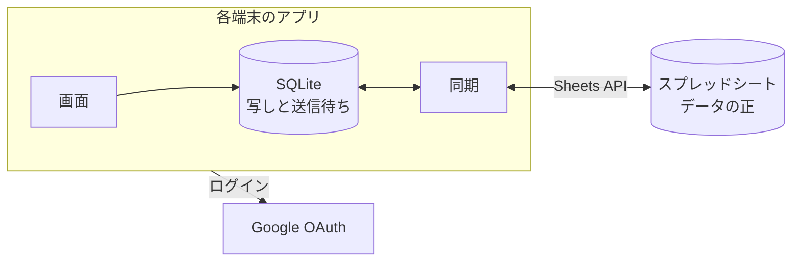

# 買い物リストアプリ 設計メモ

2026-11-01 時点の方針。2人で共有する買い物リストのためだけのモバイルアプリを、サーバーを持たずに作る。データは Google スプレッドシートに置く。

## 概要と決定事項

いちばん大事なのは軽いこと。迷ったら軽いほうを取る。

| 領域 | 決定 |
| --- | --- |
| 使う人 | 2人だけ。ストアには出さず、それぞれの Android 端末に入れる |
| クライアント | React Native(Expo の開発ビルドと Expo Router)。TypeScript。まず Android を対象にする |
| バックエンド | 持たない。アプリが Google の API を直に呼ぶ |
| データの正 | ログインしたユーザーが編集できるスプレッドシート |
| 端末の中 | SQLite に写しを持つ。画面はこれだけを読み、書き込みは裏で送る(ローカルファースト) |
| ログイン | Google の OAuth(認可コード + PKCE)。スコープは `spreadsheets`(「OAuth のスコープ」) |
| カテゴリの自動入力 | まず過去の品目から引く。AI の推定は後回し(「カテゴリを決める」) |
| 売り場の順 | 買い物の履歴から端末で計算する。逆回りを自動で見分ける(「カテゴリの順番を学ぶ」) |
| デザイン | 自前のデザインシステム。トークンを正にして lint で守らせる(voice-intercom と同じ仕組み)。配色は明るくかわいく |
| CI | GitHub Actions。リポジトリは公開にして料金を節約する |
| ライセンス | MIT |

### 利用者の決定

- バックエンドを持たず、スプレッドシートをデータベースの代わりにする。
- 対象はまず Android。React Native で作る。
- Gemini からの書き込みは、まずは考えない(「Gemini との連携」)。
- AI によるカテゴリの推定は優先度を低くする。
- スプレッドシートはあくまでデータベースの代わりで、編集は基本的にスマートフォンのアプリから行う。
- 店舗の手での順番の修正は、実際の買い物より重く扱う。

## 機能

### リストと品目

- リストは複数持てる(スーパー、コストコ、無印など)。
- 品目ごとに、品目名、カテゴリ、メモ、買ったか、を持つ。
- メモは一覧に出さない。メモのある品目に印を出し、押すとモーダルで開く。URL は押せるようにする。
- よく追加する品目は**リストごとに**出し、押すだけで追加できるようにする。
  - スコアは、そのリストの履歴の追加の回数に新しさの重みを掛けたもの。今リストにある品目は除く。
  - 新しさの重みは最後に買った日から30日で半分になる(最初の値)。
  - 入力中の候補にも同じスコアを使う。候補はまずそのリストから、足りなければほかのリストから出す。

### カテゴリを決める

カテゴリはマスタから選ぶ(鮮魚、生肉、乳製品など)。品目を追加するときは待たせず、次の順で決めて入れる。あとからいつでも直せる。

1. **同じリストの過去の品目。** 品目名を正規化して(NFKC、ひらがなへのそろえ、前後の空白の除去)引く。
2. **ほかのリストの過去の品目。**
3. どちらにも無ければ「未分類」にして、その場で選べるようにする。
4. **ローカルの推定**(後回し。下の「ローカル LLM」)が入ったら、3 の前で試す。結果はマスタの ID に限り、それ以外は捨てる。

利用者がカテゴリを直したら、それを最も強い記録として残し、次から 1・2 で使う。品目が履歴へ移っても `category_source` を写すので、強い記録のまま残る。

### ローカル LLM

**優先度は低い。** 基本の機能ができてから足す。先に作っておくのは、`CategoryInferrer` というインターフェースと「未分類」の扱いだけにする。

**方針: アプリに言語モデルを同梱しない。** 同梱すると、いちばん大事な「軽い」が崩れる。公開されている日本語の GGUF は、調べた範囲で 4GB 前後だった(1GB 未満の候補は見つけられていない)。

足すときは、次の順で試す。

| 順 | 方式 | アプリの増分 | 条件 |
| --- | --- | --- | --- |
| 1 | ML Kit の Prompt API(端末の Gemini Nano) | ほぼ無し | Pixel 10 は対応の一覧にある。Pixel 11 と、日本語で使えるかは未確認 |
| 2 | 小さな分類器。組み込みの語彙の辞書と、自分たちの履歴で学ぶ文字 n-gram の Naive Bayes | 数百 KB を目安 | どの端末でも動く |

2 は LLM ではないが、品目名からマスタの1つを選ぶだけなら十分な見込みがある。推定は裏で動かし、追加の操作を待たせない。推定で入れたカテゴリには小さな印を出し、誤りに気づけるようにする。

### 店舗

- 買い物のときに店舗を選ぶか、店舗名を入力して新しく登録する。
- 登録するときに GPS の位置を保存する。次からは今の位置に近い店舗を上に出す。
  - 距離の目安は 300m。位置の許可は「使用中のみ」で、バックグラウンドの位置は使わない。
  - 許可が無くても、最近使った順で店舗を選べる。

### チェックと買い物の記録

- 買い物の最初のチェックで店舗を選ぶ。次のチェックからは聞かず、画面の下に今の店舗を出して、押すと替えられる。店舗を選ばずにチェックもできる(その分は学習しない)。
- 店舗が同じで、前のチェックから3時間以内のチェックを、1回の買い物(トリップ)としてまとめる。
- 買った品目はトリップが終わると履歴へ移す。`trip_id` はどの端末でも同じになるよう、トリップの最初のチェックの ID にする。

### カテゴリの順番を学ぶ

店舗ごとにカテゴリの順番を持ち、一覧はこの順に並べる。元のデータはチェックの記録で、順番はそこからいつでも計算し直せる。計算は決定的にして、2台で同じ結果になるようにする。

1. **トリップを順列にする。** カテゴリごとの最初のチェックの順に並べる。チェックを外したものは除く。
2. **学習に使わないトリップを除く。** カテゴリが3つ未満のもの、カテゴリが変わるところのチェックの間隔の中央値が3秒未満のもの(レジの後にまとめてチェックした)。同じ売り場で続けて買うと間隔が短くなるので、全部のチェックの間隔は見ない。
3. **回る向きをそろえる。** その時点の順番と Kendall の τ で比べ、τ が負なら逆さにしてから数える。これで逆回りの買い物も同じ順番の学習に使える。|τ| が 0.2 未満なら向きが分からないので、重みを半分にする。学んだ順番も手の順番も無い最初のトリップは、比べる相手が無いのでそのままの向きで数える(マスタの順は売り場の向きと関係がない)。
4. **「A が B より先」の重みを足し合わせる。** 新しいトリップほど重くする。店舗の配置は変わるので、日数ではなくトリップの回数で減衰させる(1回ごとに 0.9 倍から始める)。1回の買い物に引きずられず、過去からよく回る順を出すため。
5. **手の修正を足す。** 最新の手の順番を、トリップ12回分の重みの観測として足す。減衰はトリップの 1/3 の速さにする。トリップの重みの合計は減衰 0.9 で 10 に近づくので、それより重くする(合成データのテストでは、5回分だと毎回買う売り場の修正が次のトリップで元に戻った)。
6. **順番を作る。** Copeland のスコアで並べ、隣どうしの入れ替えと挿入で、重みに逆らう量を減らす。同点はマスタの順で決める。カテゴリは30個程度なので、端末で一瞬で終わる。

手で並べ替えた直後は、その順番をそのまま出す。次に学習に使えるトリップが終わったときに、上の計算の結果へ移る。そうしないと、履歴が多い店舗では直しても順番が変わらないように見えるため。

数字(0.9、12回分、3時間など)は最初の値で、実際の買い物で調整する。合成データのテストで確かめられるよう、定数として1か所に置く。

### 昇順と降順

- 一覧は昇順と降順を手で切り替えられる。これは表示の向きだけで、学んだ順番は変えない。
- 買い物の途中で、チェックが3カテゴリに届いたら順番と比べ、τ が -0.5 以下なら自動で降順にする。トリップの中で切り替えるのは1回まで。
- 手で向きを切り替えたら、そのトリップでは自動で切り替えない。
- カテゴリの順番は手で編集できる。

## 全体の構成



### 軽さのための決まり

- 画面はネットワークを待たない。起動も操作も SQLite だけで描く。
- 依存は必要なものだけにする。足すときは大きさを確かめる。
- 書体を埋め込まない(OS の書体を使う)。voice-intercom の IBM Plex Sans JP は使わない。
- 目標は次のとおり。ミドルレンジの Android 実機で測り、悪くなったら原因を調べる。数字は仮置き。
  - 起動からリストが出るまで 1 秒以内
  - チェックの反応 100ms 以内
  - 配布物 30MB 以内

### 同期

- 書き込みは送信待ちの列に入れ、`batchUpdate` でまとめて送る。読み取りも `values.batchGet` でまとめる。Sheets API の上限は、1ユーザー・1プロジェクトあたり毎分 読み取り60回、書き込み60回。
- 読み取りは、アプリが前面に来たときと、買い物の間は30秒ごと。
- 履歴はシートの末尾に足すだけにして、読むのは前回の続きの行だけにする。
- 行の位置は信じず、ID で探す。更新の前に ID の列を読み、行を見つけてから書く。
- 同じ行の競合は版の新しいほうを取る。版は `updated_at`(`StoreOrders` は `edited_at`)で、`History` 以外のすべての表が持つ。2人が同時に同じ品目を直す頻度は低いので、これで足りる。同時刻はシートの値を残す。
- オフラインでも使える。送信待ちは残り、つながったら送る。

#### 行を消さない(墓石)

シートの行は物理削除しない。消すときは `deleted_at` のセルだけに消した時刻を書き、行の中身は残す。これを墓石と呼ぶ。`History` は足すだけなので持たない。

- **行がずれない。** 物理削除があると、ID を読んでから書くまでの間に別の端末が行を消したとき、別の行を上書きしてしまう。行を消さず、足すのも末尾だけなら、読んだ行の位置は書くときも正しい。
- **消した行が復活しない。** 消した記録が残るので、オフラインの古い編集が届いても `updated_at` の後勝ちで負ける。
- 墓石より新しい編集は、行全体を書いて `deleted_at` を空にするので、行が生き返る。墓石が遅れて届き、`updated_at` のほうが新しい行に `deleted_at` が入っても、その行は生きているとみなす。これで書く順に依らず同じ結果になる。墓石が効くのは `deleted_at` が `updated_at` 以上のときだけ。
- 読むときは墓石の行を除く。`LocalStore` から見ると、行が無くなったのと同じ。
- 同じ ID の行が重なったとき(`StoreOrders` を2台が同時に作った、応答を失った書き込みが再試行で2回届いたなど)も行は消さない。読むときも書くときも新しいほうの1行を使い、古い行は残す。空にした末尾の行は次の `appendCells` が使うので、同じ行を指した別の端末の書き込みが新しい品目を消す恐れがある。

#### 墓石は掃除しない

30日より古い墓石を空にして再利用する案は採らず、放置する。再利用すると、2台が同じ空行を同時に選んで片方の品目を上書きするので、行をずらさないことで防いだ問題が別の形で戻る。Sheets API に比較して書く手段は無い。

代わりに `Items` の行は増え続ける。品目は履歴へ移るときに墓石になるので、週に50品なら年に約2600行になる。`locate` と `pull` は全部の行を読むが、1回の読み取りで済むので、数年は問題にならない見込み。作るときの行数(2000行)を超えると `appendCells` が行を足す。足した行には入力規則が掛からないが、読むときにアプリが検査する。重くなったら、両方の端末の同期を終えた状態で古い墓石の行を手で消す、といった手入れを考える。

#### 拒否された操作の隔離

1件の不正な操作で `batchUpdate` 全体が 400 で拒否されても、ほかの操作を詰まらせない。

- 拒否されたら半分に分けて送り直し、原因の1件まで絞る。行がずれないので、読み直さずに同じ計画を分けられる。書き込みの回数は上限の中で数え、書けた分はその都度確認する。
- 原因の操作は送信待ちに残したまま送らず、同期のたびに `issues` で知らせる。行はシートの値に戻らず、利用者の変更を失わない。`row` は行がまだ無ければ 0 にする。
- 同じ行をもう一度直すと、新しい操作は試す。隔離は同期の処理のメモリの中だけなので、アプリを開き直すと1回だけ試し直す(原因が直っていれば通る)。

## スプレッドシート

### シート

| シート | 内容 | 主な列 |
| --- | --- | --- |
| `Lists` | リストのマスタ | `id`、`name`、`sort`、`updated_at`、`deleted_at` |
| `Categories` | カテゴリのマスタ | `id`、`name`、`sort`、`updated_at`、`deleted_at` |
| `Stores` | 店舗のマスタ | `id`、`name`、`lat`、`lng`、`created_at`、`updated_at`、`deleted_at` |
| `Items` | 今リストにある品目 | `id`、`list_id`、`name`、`category_id`、`category_source`、`memo`、`checked`、`checked_at`、`checked_store_id`、`updated_at`、`deleted_at` |
| `History` | 買い終えた品目の記録(足すだけ) | `id`、`list_id`、`name`、`category_id`、`category_source`、`store_id`、`trip_id`、`checked_at`、`checked_seq` |
| `StoreOrders` | 店舗ごとの手の順番 | `store_id`、`category_ids`、`edited_at`、`deleted_at` |
| `Meta` | スキーマの版 | `schema_version` |

`category_source` は `history`、`inferred`、`user`。`category_ids` は ID をコンマでつなぐ。`deleted_at` は「行を消さない(墓石)」のとおりで、アプリの行の型には持たない。

`History` の `id` は元の品目の ID にする。2台が同じトリップを履歴へ移しても、読むときに ID で重なる。`trip_id` はトリップの最初のチェックの ID で、`category_source` は品目からそのまま写す(`historyEntriesFromTrip`)。

### 変なデータを入れにくくする

シートを直接触っても壊れにくいよう、アプリが作るときに設定する。

- `Items` の `checked` はチェックボックス、日時の列は ISO 8601 の UTC の文字列のまま持ち(シートの時差の解釈を避ける)形式を検査、ID の列は形式の検査、カテゴリとリストの列は該当の ID のプルダウン(`ONE_OF_RANGE`)。不正な値は拒否する(`strict`)。
- すべてのシートに、編集すると警告を出す保護(`warningOnly`)を付ける。2人の権限はそのままなので、強い保護は要らない。
- `spreadsheets` の API からの書き込みに入力規則が効くかは未確認。読むときもアプリが検査し、不正な行は取り込まずに画面で知らせる。

### アプリを始める流れ

1. 1人目が Google でログインし、アプリがスプレッドシートを作り、入力規則と保護と初期のカテゴリを入れる。
2. 1人目が Google スプレッドシートの画面からもう1人に編集の権限を渡す。
3. もう1人がログインして、シートの URL を貼る(アプリの QR コードでもよい)。

## OAuth のスコープ

**決定: `https://www.googleapis.com/auth/spreadsheets` を使い、公開ステータスを「本番環境」にする。審査は受けない。**

| 案 | 長所 | 短所 |
| --- | --- | --- |
| `spreadsheets`(採用) | 共有されたシートを ID だけで開ける。実装が単純 | 機密性の高いスコープなので、未確認アプリの警告を各自が1回通る |
| `drive.file` | 機密性の低いスコープで警告が出ない。アクセスがファイルごとに絞られる | アプリが作ったか、Picker で選んだファイルだけに触れる。もう1人は Picker を通す必要があり、モバイルの Picker はシステムのブラウザで開いてリダイレクトで戻す作りになる |

- 公開ステータスが「テスト」だと、リフレッシュトークンが7日で切れる。毎週ログインし直すのは受け入れられないので、本番環境にする。
- 個人の利用(知り合いだけの100人未満)は審査の例外に当たる。未確認アプリの警告は出て、ユーザー数の上限100人が残る。2人なら問題ない。ただし Google の説明が場所によって揺れているので、実際に切り替えて確かめる。
- リフレッシュトークンは端末の安全な保管場所に置く。

## Gemini との連携

**決定(利用者): まずは考えない。** 今の設計には Gemini のための作りを入れない。

あとで考えるときのために、2026-11-01 に公式の文書で確かめた範囲を残す。スプレッドシートにすれば Gemini のアプリから自由に足せる、とは言えなかった。

| 経路 | 状況 |
| --- | --- |
| Gemini アプリの接続アプリ(Sheets) | 既存のシートを編集できるとは書かれていない。ヘルプはスプレッドシートを作成できないとしている |
| Gemini アプリのファイル生成(2026-10-29 の発表) | 新しいスプレッドシートを生成する機能で、Web だけ。既存のシートの編集には触れていない |
| Sheets の中の Gemini(PC の横のパネル) | 行の追加ができる。提案を「適用」で確定する。対象のプランが要る |
| Sheets の中の Gemini(モバイル) | ヘルプの iPhone・iPad の説明では、直接編集できない |
| Gemini アプリから Google Keep | Android で既存のリストに項目を足せる。ただし Keep API は企業の管理者向けに見え、アプリから読めない見込み |
| Gemini アプリから Google Tasks | タスクの追加ができる。Tasks API もあるので、アプリから読める |

スマートフォンから足すなら、Google Tasks のリストをアプリが取り込む案がいちばん現実的に見える。Tasks のスコープの機密性の区分は確かめていない。

## リポジトリと公開

`InoueDaiki/shopping-list` として公開する(GitHub Actions の料金を抑えるため)。ライセンスは MIT。

書かないもの:

- 実名、個人のメールアドレス、家族の情報。コミットの著者は `InoueDaiki` と GitHub の noreply のメールにする(リポジトリの git config で固定する)。
- スプレッドシートの ID と URL、実際の買い物の内容、店舗の実際の位置。テストの値は架空のものにする。
- 秘密情報(トークン、`.env`、署名の鍵、`google-services.json` など)。OAuth のクライアント ID も `.env` から渡し、リポジトリに入れない。

CI はフォークの PR からも動くので、Secrets を使わない形にする。

## 技術の選定

voice-intercom を土台にして、サーバーと Web が無い分を削る。版は voice-intercom の `mise.toml` と `apps/mobile/package.json` にそろえて始める。

| 項目 | 同じにするもの | 違うところと理由 |
| --- | --- | --- |
| ツールの版 | mise、Node、pnpm の workspace | Python、Terraform、buf、LiveKit は要らない |
| 開発環境 | ホストは Apple Silicon | devContainer は使わない(モバイルだけでホストで開発するため)。iOS の CocoaPods などは入れない |
| アプリ | Expo の開発ビルド、Expo Router | TanStack Query は使わない。読み取りは SQLite なので、サーバーの状態を取得する層が要らない |
| ログイン | expo-auth-session、expo-secure-store | Cognito ではなく Google。Android のクライアント(パッケージ名と署名の SHA-1 で登録)に合う戻り方を PoC で確かめ、合わなければ Google の SDK のログインに替える |
| 共有の処理 | 画面を持たない `packages/core`(DOM も React Native も使わない) | 端末に依るところ(SQLite、Sheets、位置、推定)はインターフェースにして差し込む |
| デザイン | `packages/design-tokens`、`packages/ui-native`、Uniwind、Lucide、oxlint の検査 | `ui-web` と見本帳は作らない。見本は開発ビルドだけの画面にする |

足すもの: `expo-sqlite`、`expo-location`。

```text
apps/mobile             画面(Expo Router)
packages/core           リスト、カテゴリの決定、順番の学習、同期(純粋な TypeScript)
packages/sheets         Sheets API の呼び出しとスキーマ、入力規則の定義
packages/design-tokens  デザイントークン
packages/ui-native      UI 部品
```

## デザインシステム

仕組みは voice-intercom と同じにする。

- 値の正は `packages/design-tokens/src/tokens.ts`。`mise run gen` で Uniwind のテーマ、React Native の値、`TOKENS.md` を生成し、生成物もコミットする。
- 色は役割の名前で、OKLCH で書く。明暗の両方を持ち、OS の設定で切り替える。
- テストで sRGB に収まることと、文字と地の組み合わせが WCAG 2 の AA を満たすことを確かめる。
- `pnpm lint:design`(oxlint)が、トークンにないクラス、生の色、`dark:`、`style` での色を落とす。
- 画面はまず部品を使う。アイコンは Lucide で、絵文字を代わりにしない。

### 配色

[Catppuccin](https://github.com/catppuccin/palette)(MIT)の明るい配色 Latte を下敷きにする。やわらかい地に、ピンクやピーチなどの色が揃っていて、買い物のメモ帳のようなかわいさに合う。

| 役割 | 元の色 | 値 |
| --- | --- | --- |
| 地 | base | `#eff1f5` |
| 本文 | text | `#4c4f69` |
| 主な操作 | pink | `#ea76cb` |
| 差し色 | peach | `#fe640b` |
| 買った | green | `#40a02b` |
| 注意 | red | `#d20f39` |

そのままでは白い文字とのコントラストが足りない組み合わせがあるので、色相を保って OKLCH の明るさを調整する。カテゴリの札の色はマスタごとに決め、生肉は赤系、鮮魚は青系、乳製品はクリーム系のように売り場を思い出せる色にする。

## テスト

| 層 | 道具 | 対象 | CI |
| --- | --- | --- | --- |
| 純粋な処理 | Vitest | カテゴリの決定、順番の学習、向きの判定、同期の競合、スキーマの検査 | 毎回 |
| トークン | Vitest | sRGB、コントラスト比 | 毎回 |
| 画面 | Vitest と React Native Testing Library | 主な画面のふるまい | 毎回 |
| 端末の E2E | Maestro と Android エミュレーター | デモモード(Remote なし)のリリース APK で、リストと品目の追加、店舗の登録、順番の変更、降順、カテゴリの修正の流れ(`e2e/`)。同期は含めない | main への push |
| Sheets の実物 | 手で動かすスクリプト | 入力規則と保護の作成、読み書き。テスト用のシートに対して手元で動かす | 動かさない |

順番の学習は、合成の店舗(正解の順番がある)から、順回り、逆回り、寄り道、まとめてのチェックを混ぜたトリップを作り、正解に近づくことを確かめる。

## CI

voice-intercom と同じ形にする。

- PR と main への push で動く。ジョブの中身は `mise run` のタスクとそろえる。
- 準備(mise、pnpm とそのキャッシュ)は `.github/actions/setup` にまとめる。
- action はタグではなくコミット SHA で固定し、横にタグを書く。`persist-credentials: false` を付ける。
- `ci.yml`: lint と型検査、テスト。`gen.yml`: 生成物が古ければ落とす。`android.yml`: main への push でリリース APK をビルドする(開発用の鍵。成果物は残さない)。
- PR は同じブランチの古い実行を止める。

## 作る順番

1. **PoC。** 手元の Pixel の実機で確かめる。
   - Google ログインと、本番環境でログインが7日を超えて続くこと
   - 2つのアカウントで同じシートを読み書きできること
2. リポジトリ、CI、デザインシステムの土台。
3. リスト、品目、同期。
4. 店舗、チェック、順番の学習。
5. よく使う品目、過去の品目からのカテゴリの自動入力。
6. 余裕があれば AI の推定。

## 配布

署名したリリースのビルドの APK を2台に直接入れる。ストアは使わない。署名の鍵はリポジトリに入れず、手元に保管する。鍵を失くすと上書きで更新できず、OAuth のクライアントの SHA-1 も変わる。手順は README の「配布」。

### APK の大きさ

**実測(2026-11-01): 27.8MB(27,829,783 バイト)。目標の 30MB に収まった。** 開発用の鍵で署名したリリースの APK で、画面はまだ入口だけ。画面と依存が増えた分は増える。

| 段階 | 大きさ |
| --- | --- |
| arm64-v8a のみ、R8、リソース縮小、GIF と WebP の Fresco を外す | 33.2MB |
| さらに、使わないネイティブのモジュールを外し、アイコンを1つずつの import にする | 27.8MB |

内訳(27.8MB の時点。APK の中で占める大きさ):

| 中身 | 大きさ |
| --- | --- |
| ネイティブのライブラリ(`lib/arm64-v8a`) | 20.8MB。`libreactnative.so` 7.0MB、`libhermesvm.so` 2.7MB、`libexpo-sqlite.so` 1.7MB、`libexpo-modules-core.so` 1.6MB、`libappmodules.so` 1.5MB、`libc++_shared.so` 1.3MB、`react-native-screens` 1.2MB |
| `classes.dex` | 2.6MB(展開すると 5.7MB) |
| JS(Hermes のバイトコード) | 2.5MB |
| `resources.arsc` | 1.0MB |
| その他のリソース | 0.5MB |

決めたこと:

- **対応は `arm64-v8a` だけ。** 対象の端末は 64 ビットの Android だけなので、32 ビットと x86 は入れない。エミュレーターも Apple Silicon では arm64 で動く。
- **R8 とリソース縮小を使う。** JS は Hermes(既定)。
- **ネイティブのライブラリは圧縮しない**(`useLegacyPackaging` は既定の false)。圧縮すると APK は小さくなるが、端末に展開されて入れた後の大きさが増え、起動も遅くなる。JS のバンドルも同じ理由で圧縮しない。目標に収まっているので、起動を優先する。
- **自動リンクから外す**(`apps/mobile/package.json` の `expo.autolinking.exclude`)。`expo-router` の依存(とその peer)として入るが、画面からは使わないネイティブのモジュール。
  - `react-native-reanimated`、`react-native-worklets`(2つで約 3MB)、`react-native-gesture-handler`: バンドルに JS が入っていないことをソースマップで確かめた。ドロワーや JS のスタックを使うときに要る。
  - `@react-native-masked-view/masked-view`: `expo-router` の JS から import されるが、ネイティブが無ければ子をそのまま描く作りで、Android のヘッダーのこの部品は省ける。
- **アイコンは1つずつ import する。** `lucide-react-native` の入口から import すると、Metro は全部のアイコン(約1900個)をバンドルに入れる。これで JS が 4.0MB から 2.5MB になった。起動のときに読むコードも減る。入口からの import は oxlint で落とす。
- **権限を外す**(`android.blockedPermissions`)。テンプレートやライブラリが入れるが使わないもの: 外部ストレージの読み書き、`SYSTEM_ALERT_WINDOW`、`VIBRATE`、`USE_BIOMETRIC`、`USE_FINGERPRINT`、インストールリファラー。残るのは位置(粗い・細かい)と `INTERNET`、ライブラリの内部用の `DYNAMIC_RECEIVER_NOT_EXPORTED_PERMISSION`。

エミュレーターでリリースの APK が起動し、入口の画面が出ることは確かめた。ログインや SQLite など、画面から使っていないネイティブの処理は、R8 を通した状態ではまだ動かしていない。起動時間の目標はミドルレンジの実機で測る。

足すときの注意: `react-native-reanimated` などを使う部品を足すと、自動リンクから外したままでは起動や描画で落ちる。使うなら `exclude` から消し、大きさを測り直す。

## 未確認のこと

- API の書き込みに入力規則が効くか。
- ML Kit の Prompt API が Pixel 11 で使えるか、日本語の分類に使えるか(推定を足すときに確かめる)。

## 参考

- [Sheets API のスコープ](https://developers.google.com/workspace/sheets/api/scopes)
- [Drive API のスコープ](https://developers.google.com/workspace/drive/api/guides/api-specific-auth)
- [デスクトップとモバイルの Picker](https://developers.google.com/workspace/drive/picker/guides/overview-desktop)
- [Sheets API の使用量の上限](https://developers.google.com/workspace/sheets/api/limits)
- [未確認アプリ](https://support.google.com/cloud/answer/7454865?hl=en)
- [審査が要らない場合](https://support.google.com/cloud/answer/13464323?hl=en)
- [Gemini in Sheets](https://support.google.com/docs/answer/14356410?hl=en)
- [Gemini アプリのファイル生成](https://workspaceupdates.googleblog.com/2026/10/create-preview-and-edit-files-directly-in-the-Gemini-app.html)
- [Gemini アプリの接続アプリ](https://support.google.com/gemini/answer/14959807)
- [Gemini アプリと Keep](https://support.google.com/gemini/answer/15230597)
- [Google Tasks API](https://developers.google.com/workspace/tasks/reference/rest)
- [Google Keep API](https://developers.google.com/workspace/keep/api/guides)
- [ML Kit GenAI](https://developers.google.com/ml-kit/genai)
- [Catppuccin の配色](https://github.com/catppuccin/palette)
