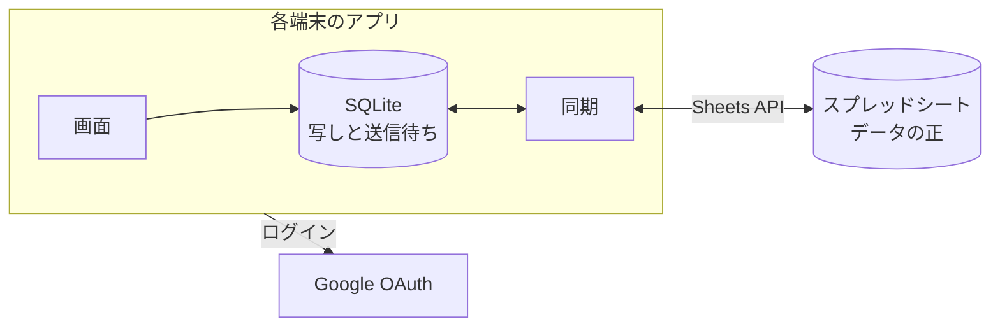

# 買い物リストアプリ 設計メモ

2026-11-01 時点の方針。2人で共有する買い物リストのためだけのモバイルアプリを、サーバーを持たずに作る。データは Google スプレッドシートに置く。

## 概要と決定事項

いちばん大事なのは軽いこと。迷ったら軽いほうを取る。

| 領域 | 決定 |
| --- | --- |
| 使う人 | 2人だけ。ストアには出さず、それぞれの Android 端末に入れる |
| クライアント | React Native(Expo の開発ビルドと Expo Router)。TypeScript。まず Android を対象にする |
| バックエンド | 持たない。アプリが Google の API を直に呼ぶ |
| データの正 | ログインしたユーザーが編集できるスプレッドシート |
| 端末の中 | SQLite に写しを持つ。画面はこれだけを読み、書き込みは裏で送る(ローカルファースト) |
| ログイン | Google の OAuth(認可コード + PKCE)。スコープは `spreadsheets`(「OAuth のスコープ」) |
| カテゴリの自動入力 | まず過去の品目から引き、無ければ端末の中で推定する(「カテゴリを決める」) |
| 売り場の順 | 買い物の履歴から端末で計算する。逆回りを自動で見分ける(「カテゴリの順番を学ぶ」) |
| デザイン | 自前のデザインシステム。トークンを正にして lint で守らせる(voice-intercom と同じ仕組み)。配色は明るくかわいく |
| CI | GitHub Actions。リポジトリは公開にして料金を節約する |
| ライセンス | MIT |

### 利用者の決定

- バックエンドを持たず、スプレッドシートをデータベースの代わりにする。
- 対象はまず Android。React Native で作る。
- Gemini からの書き込みは、まずは考えない(「Gemini との連携」)。
- カテゴリの推定は言語モデルを同梱せず、小さな分類器で端末の中で行う(「ローカル LLM」)。
- スプレッドシートはあくまでデータベースの代わりで、編集は基本的にスマートフォンのアプリから行う。
- 店舗の手での順番の修正は、実際の買い物より重く扱う。

## 機能

### リストと品目

- リストは複数持てる(スーパー、コストコ、無印など)。
- 品目ごとに、品目名、カテゴリ、メモ、買ったか、を持つ。
- メモは一覧に出さない。メモのある品目に印を出し、押すとモーダルで開く。URL は押せるようにする。
- よく追加する品目は**リストごとに**出し、押すだけで追加できるようにする。
  - スコアは、そのリストの履歴の追加の回数に新しさの重みを掛けたもの。今リストにある品目は除く。
  - 新しさの重みは最後に買った日から30日で半分になる(最初の値)。
  - 入力中の候補にも同じスコアを使う。候補はまずそのリストから、足りなければほかのリストから出す。
- 品目のマスタは持たない。入力中の候補、よく使う品目、カテゴリの引き当て、推定の学習は、すべて `History` から作る(下の「品目名を忘れる」)。

#### リストに属さない品目(野良品目)

Android のウィジェットから開く品目の追加画面(リストを決めずに開く)で、候補を選ばずに足した品目は、どのリストにも属さない品目(`Items` の `list_id` が空)として記録する。

- **足す。** 名前だけで足す(`addStrayItem`)。カテゴリはリストの入力欄と同じく「カテゴリを決める」の順で決めるが、リストが無いので 1 は無く、どのリストの記録も 2 として見る。分からなければ未分類で入れて裏で推定する。同じ名前の買っていない野良品目があれば足さない。
- **出す場所。** リストの画面、よく使う品目、入力の候補、リストの件数には出さない。リスト一覧の、リストの並びの下に、野良品目があるときだけ「未整理」の行を件数付きで出す。開くと野良品目の一覧で、行を押してリストを選ぶと移り(`moveStrayItem`)、「〇〇を開く」でそのリストへ進める。払うと消え、5秒は取り消せる(品目の削除と同じ `usePendingDelete`)。
- **移す。** `list_id` を入れて `updated_at` を進める。利用者が決めたカテゴリでなければ、移す先のリストの記録で引き直す(同じリストの記録がいちばん強いため)。移す先に同じ名前の買っていない品目があれば、野良品目を消してそちらを使う。
- **チェックしない。** どのリストの買い物でもないので、チェックも履歴への移動もしない(シートを手で直してチェック済みになっても、トリップに数えない)。
- **片付けで消さない。** 同期のたびの「リストの無い品目」の片付け(「リストを消したときの品目と店舗」)は、消えたリストを指す品目だけを墓石にし、`list_id` が空の品目は残す。
- **追加画面の候補。** すべてのリストをまたいで、入力に合う過去の品目名を、同じ名前でもリストごとに別の候補として出す(`crossListSuggestions`。牛乳(リスト A)、牛乳(リスト B))。照合、スコア、忘れた品目の除外、今そのリストにある品目の除外は入力中の候補と同じで、リストをまたいでスコアの高い順に並べる。同点は名前、リストの `sort` の順。消したリストの履歴は出さない。

#### 品目名を忘れる

打ち間違いなどで履歴に入った品目名を、リストの一覧の「…」の「品目の管理」から消せる。`History` は足すだけで、端末は末尾の続きしか読まないので、過去の行を書き換えても相手の端末に届かない。そこで「忘れる」記録を別の表(`ForgottenItems`)に足す。

- **効き目。** 同じリストで、正規化した名前(「カテゴリを決める」の正規化)が同じで、`checked_at` が `forgotten_at` 以下の履歴を、入力中の候補、よく使う品目、カテゴリの引き当て、推定の学習から除く(`withoutForgotten`)。忘れた後にまた買えば、その分からまた出る。記録を消すのではなく、それより前を見ない。
- **リストごと。** 品目の管理はリストの画面の続きなので、そのリストだけで忘れる。ほかのリストの履歴に同じ名前があれば、そちらからは「ほかのリスト」の候補やカテゴリの引き当てに出る。
- **履歴は残す。** 売り場の順の学習(「カテゴリの順番を学ぶ」)は品目名に依らないので、忘れた分も使い続ける。
- **画面。** そのリストの忘れていない履歴を名前ごとにまとめ、最後に買った日の新しい順に、回数とカテゴリと一緒に出す(`registeredItems`)。検索の入力欄で名前の一部から絞る。行を横に払うと忘れ、5秒は取り消せる(品目の削除と同じ `usePendingDelete`)。行を押しても何もしない。
- **記録。** 同じリストの同じ名前の記録があれば、`forgotten_at` と `updated_at` を進めて使い回す。2台が同時に忘れて記録が2つになっても、新しいほうの時刻が効く。端末の時計がずれて履歴のほうが新しいときは、`forgotten_at` をその履歴の時刻にする(今出ている分は必ず消える)。
- **仮決め:** 並びは最後に買った日の新しい順にする(打ち間違いはたいてい最近のもののため)。

### カテゴリを決める

カテゴリはマスタから選ぶ(鮮魚、生肉、乳製品など)。品目を追加するときは待たせず、次の順で決めて入れる。あとからいつでも直せる。

1. **同じリストの過去の品目。** 品目名を正規化して(NFKC、ひらがなへのそろえ、前後の空白の除去)引く。
2. **ほかのリストの過去の品目。**
3. どちらにも無ければ「未分類」でいったん入れる。追加のときに分類は聞かない。あとで編集で直せる。
4. 同時に**ローカルの推定**(下の「ローカル LLM」)を裏で走らせ、結果が出たときに品目がまだ未分類なら入れる。結果はマスタの ID に限り、それ以外は捨てる。

利用者がカテゴリを直したら、それを最も強い記録として残し、次から 1・2 で使う。品目が履歴へ移っても `category_source` を写すので、強い記録のまま残る。

推定で入ったカテゴリは最も弱い記録として扱う。1・2 で引いた結果が推定の記録だけなら、`category_source` も `inferred` のままにする(`history` にすると強い記録に化けるため)。

### ローカル LLM

**方針: アプリに言語モデルを同梱しない。** 同梱すると、いちばん大事な「軽い」が崩れる。公開されている日本語の GGUF は、調べた範囲で 4GB 前後だった(1GB 未満の候補は見つけられていない)。

検討した方式は次のとおり。今は 2 を使う。

| 順 | 方式 | アプリの増分 | 状況 |
| --- | --- | --- | --- |
| 1 | ML Kit の Prompt API(端末の Gemini Nano) | ほぼ無し | 見送り。Pixel 10 は対応の一覧にあるが、Pixel 11 と、日本語で使えるかは未確認で、ネイティブの依存も要る |
| 2 | 小さな分類器。組み込みの語彙の辞書と、自分たちの履歴で学ぶ文字 n-gram の Naive Bayes | 数十 KB | 採用。どの端末でも動く |

2 は LLM ではないが、品目名からマスタの1つを選ぶだけなら足りる。実装は `packages/core` の `createCategoryInferrer`(`CategoryInferrer` の実装)で、品目名を `normalizeItemName` で正規化してから、次の順で決める。

1. **組み込みの語彙の辞書**(`inference-dictionary.ts`)。完全一致、語尾の最長の語、どこかの最長の語の順に見る。語尾の数量(「卵10個」「牛乳 1L」)は除いて比べる。日本語の複合語は後ろが中心なので、「チーズパン」は「チーズ」より語尾の「パン」を取る。
   - 語尾以外で、1文字の語とかな2文字の語は完全一致だけに使う。語尾では漢字の1文字と「パン」も使う(「りんご酢」)。かな2文字は「ふともも」のように紛れるので語尾でも使わない。
   - 語彙は2つに分ける。手で整えた約 1,800 語(`inference-dictionary.ts`)と、LLM で作って機械的に絞った約 1.5 万語(`inference-dictionary-extra.ts`、`scripts/build-dictionary.mts` で書き出す)。後者は、今の引き方で既に同じカテゴリに決まる語を除いて作ったので、新しい品目名か、語尾に引かれて別のカテゴリへ誤る複合語(「冷凍ハンバーグ」「幸水」)だけが入る。5 万語を目指したが、意味のある語はこの数で尽きた。重なれば手の辞書を優先する。
   - 生成した語は正規化した形で持ち、起動の後に正規化し直さない。表は入力欄に触れたときに裏で作る(Node で 3ms)。部分一致は品目名の切れ端を1つずつ表で引くので、引く時間は語数ではなく品目名の長さで決まる。いちばん長い語より長い切れ端は引かない。
   - 辞書のキーは初期のカテゴリの名前で、ID は持たない。マスタと名前で突き合わせるので、利用者が名前を変えたカテゴリや消したカテゴリは候補にならない。
2. **履歴の Naive Bayes。** 辞書で決まらないときだけ使う。文字の 2-gram と 3-gram で、履歴のカテゴリを学ぶ。自分の推定で強化しないよう、`category_source` が `inferred` の記録は使わない。同じ名前を何度買っても1回と数える。
   - 次のすべてを満たすときだけ答える。確率が 0.9 以上、そのカテゴリで学んだ品目名が3つ以上、品目名の n-gram の 3 割以上をそのカテゴリで見たことがある。
   - 辞書より先に見ていたときは、学習した分だけ正しい答えを壊した(模擬の履歴で、辞書と違う答えのほとんどが誤りだった)。文字の並びは語の意味を表さないため。利用者の修正は、同じ名前なら「カテゴリを決める」の 1・2 が先に引く。
3. どちらでも決まらなければ未分類のままにする。

**検証。** 調整に使っていない 448 件(辞書を見ない別の作業者が作った一般的な品目)で、辞書だけなら正解 84%、誤り 2%、未分類 14%。生成した語彙を足す前後で、同じく辞書を見ずに作った別の 2,000 件(珍しい品目と数量付きを多めに混ぜた)を測ると、正解 79.0% → 96.8%、誤り 4.2% → 2.1%、未分類 16.8% → 1.1%。残る誤りの多くは売り場の考え方の違い(練り物を「豆腐・納豆」に置くか「鮮魚」に置くか)。履歴に品目名が 441 種類あると正解 88%、誤り 4%、未分類 9%。履歴は当たりを増やす分、誤りも増やす。未分類は害が小さいので、確信の条件は緩めない。実際の買い物の品目では測っていない。調整に使った 441 件(`inference-eval-data.ts`)はテストで回帰を見る。

推定は裏で動かし、追加の操作を待たせない。モデルは履歴の配列の参照が変わったときだけ作り直す。今の品目で学ばないのは、足すたびに学習し直さないため。途中で利用者がカテゴリを決めたら上書きしない。推定で入れたカテゴリの品目には一覧で小さく「推定」と出し、誤りに気づけるようにする。利用者が直すと `user` になり、印は消える。

### 店舗

- 買い物のときに店舗を選ぶか、店舗名を入力して新しく登録する。
- 店舗は1つのリストに属する(`list_id`)。リストの画面には、そのリストの店舗と `list_id` が空の店舗だけを出し、新しい店舗はそのリストに登録する。
- 登録するときに GPS の位置を保存する。次からは位置の分かる店舗を近い順に上に出す。
  - 300m 以内の店舗には「近い」の印を出す。位置の許可は「使用中のみ」で、バックグラウンドの位置は使わない。
  - 位置の無い店舗と許可が無いときは、最近使った順で後ろに出す。
- **仮決め:** 同じリストで同じ店舗名(`normalizeItemName` で同じ)を新しく登録しようとしたら、足さずに既存を使う。既存の位置は書き換えない。別のリストなら同じ名前を別の店舗として持てる。`list_id` が空の同じ名前の店舗も既存として扱い、そのリストに属させる。
- 店舗の編集画面でリストと位置を変えられる。位置は今の位置か、Google マップの長押しでコピーした「緯度, 経度」を貼る。地図のライブラリは重いので入れず、確かめるときは `geo:` の URL で地図のアプリを開く。
- リスト一覧の下に、全部の店舗で最も近い店舗で買い物を始めるボタンを出す(`nearestStore`)。20km より遠ければ出さない。位置を測るのは、位置を持ちリストに属する店舗があるときに一覧へフォーカスしたときだけで、店舗が無ければ許可を求めない。押すと店舗を選んだ状態でリストを開くので、最初のチェックで店舗を聞かない。

#### `list_id` が空の店舗(移行の途中)

リストに属する前に登録した店舗は `list_id` が空になる。どのリストにも出し、次のどちらかで埋める。

- あるリストで選ぶか、そのリストで同じ名前を登録すると、そのリストに属する。
- 同期のたびに、チェックの記録(`Items` の `checked_store_id` と `History` の `store_id`)から埋める。複数のリストで使っていたら最後に使ったリストにする。消えたリストの記録は見ない。一度も使っていない店舗は空のまま残る。

### チェックと買い物の記録

- 買い物の状態(今の店舗、向き)は端末に1つで、リストに結びつく。別のリストではセッションなしとして扱い、そのリストで操作すると置き換わる。前のリストの店舗が帯に出たり、そのチェックに付いたりしないようにするため。`listId` の無い保存済みの状態は無視する。
- 買い物の最初のチェックで店舗を選ぶ。次のチェックからは聞かず、画面の下に今の店舗を出して、押すと替えられる。店舗を選ばずにチェックもできる(その分は学習しない)。
- **仮決め:** 店舗を替えるとき、今のトリップの最後のチェックから5分以内は訂正として、このトリップのチェックを新しい店舗へ付け替える。5分を超えていれば別の店舗へ移ったとみなし、前のチェックはそのままで、以後を新しいトリップにする(向きも初めに戻す)。2軒回りで前の店舗の学習が汚れないように。店舗を選ばずにチェックした分も同じで、5分を過ぎてから店舗を選んでも付かない。
- 店舗が同じで、前のチェックから3時間以内のチェックを、1回の買い物(トリップ)としてまとめる。
- 買った品目はトリップが終わると履歴へ移す。`trip_id` はどの端末でも同じになるよう、トリップの最初のチェックの ID にする。

### カテゴリの順番を学ぶ

店舗ごとにカテゴリの順番を持ち、一覧はこの順に並べる。元のデータはチェックの記録で、順番はそこからいつでも計算し直せる。計算は決定的にして、2台で同じ結果になるようにする。

1. **トリップを順列にする。** カテゴリごとの最初のチェックの順に並べる。チェックを外したものは除く。
2. **学習に使わないトリップを除く。** カテゴリが3つ未満のもの、カテゴリが変わるところのチェックの間隔の中央値が3秒未満のもの(レジの後にまとめてチェックした)。同じ売り場で続けて買うと間隔が短くなるので、全部のチェックの間隔は見ない。
3. **回る向きをそろえる。** その時点の順番と Kendall の τ で比べ、τ が負なら逆さにしてから数える。これで逆回りの買い物も同じ順番の学習に使える。|τ| が 0.2 未満なら向きが分からないので、重みを半分にする。学んだ順番も手の順番も無い最初のトリップは、比べる相手が無いのでそのままの向きで数える(マスタの順は売り場の向きと関係がない)。
4. **「A が B より先」の重みを足し合わせる。** 新しいトリップほど重くする。店舗の配置は変わるので、日数ではなくトリップの回数で減衰させる(1回ごとに 0.9 倍から始める)。1回の買い物に引きずられず、過去からよく回る順を出すため。
5. **手の修正を足す。** 最新の手の順番を、トリップ12回分の重みの観測として足す。減衰はトリップの 1/3 の速さにする。トリップの重みの合計は減衰 0.9 で 10 に近づくので、それより重くする(合成データのテストでは、5回分だと毎回買う売り場の修正が次のトリップで元に戻った)。
6. **順番を作る。** Copeland のスコアで並べ、隣どうしの入れ替えと挿入で、重みに逆らう量を減らす。同点はマスタの順で決める。カテゴリは30個程度なので、端末で一瞬で終わる。

手で並べ替えた直後は、その順番をそのまま出す。次に学習に使えるトリップが終わったときに、上の計算の結果へ移る。そうしないと、履歴が多い店舗では直しても順番が変わらないように見えるため。

数字(0.9、12回分、3時間など)は最初の値で、実際の買い物で調整する。合成データのテストで確かめられるよう、定数として1か所に置く。

### 昇順と降順

- 一覧は昇順と降順を手で切り替えられる。これは表示の向きだけで、学んだ順番は変えない。
- 買い物の途中で、チェックが3カテゴリに届いたら順番と比べ、τ が -0.5 以下なら自動で降順にする。トリップの中で切り替えるのは1回まで。
- 手で向きを切り替えたら、そのトリップでは自動で切り替えない。
- **仮決め:** 順番を学んでいない店舗(学習に使える終わったトリップも手の順番も無い)では自動で切り替えない。比べる相手がマスタの順しか無く、売り場の向きと関係がないため。
- カテゴリの順番は手で編集できる。

### ホーム画面のウィジェット

アプリを開いて一覧を探さずに品目を足せるよう、入口を2つ置く。どちらも `shoppinglist://quick-add` を開き、Expo Router の `(app)/quick-add` の画面(品目の追加)を出す。

- **ウィジェット。** ホーム画面に置く 2×1 のボタン「品目を追加」。見た目はアプリの主な操作のボタン(丸い端の `primary`)に合わせ、明暗はトークンの `primary` と `on-primary` を OS の設定で切り替える。Android のウィジェット(RemoteViews)には文字の入力欄を置けないので、ボタンだけにする。中身は変わらないので定期の更新はしない。
- **ショートカット。** アプリのアイコンを長押しすると出る「品目を追加」(静的なショートカット)。
- **画面。** 透明に重ねた画面に、ほかの画面と同じ下から出る面を描く。`Sheet` は Modal(別の窓)で、開いてすぐ入力欄にフォーカスしても Android のキーボードが出ないので、Modal を使わない `SheetPanel` を直に置く。下には一覧を敷いておき(`(app)/_layout.tsx` の `unstable_settings`)、閉じると一覧に出る。アプリの中で開いた(リンクを踏んだ)ときは、閉じると開く前の画面に戻る。ログインしていない、またはシートが決まっていないときは、いちばん外のレイアウトの分岐のとおりログインや準備の画面に出て、追加の画面は開かない。
- **タスクを作り直す。** ウィジェットもショートカット(ランチャーが付ける)も、アプリのタスクを作り直して開く。裏でプロセスだけ落ちてタスクが残っていると(OS がメモリのために落としたとき)、作り直さなければ前のタスクが前に出るだけで、リンクが画面に届かなかった(エミュレーターで確かめた)。代わりに、開いていたリストの画面などは残らず、追加の画面の下は一覧になる。ホーム画面から開くので、戻る先が一覧でも困らない。
- **中身。** 入力欄にすぐフォーカスし、打つと `crossListSuggestions` の候補を、リストの名前を添えて出す。候補を押すとそのリストへ足し(リストの入力欄と同じく、過去の品目からカテゴリを決め、分からなければ裏で推定する)、「〇〇を開く」でそのリストへ進める。候補を選ばずに「追加」(キーボードの確定も同じ)を押すと野良品目として未整理に入り、「リストを選ぶ」で移すとそのリストの画面へ進む。同じ名前のまだ買っていない品目があれば足さず、「すでに〇〇にあります」と出す。続けて足せるよう、足すと入力欄を空にする。
- 読み上げでは「追加」のボタンを「未整理に追加」と読む。下の画面にも「追加」があり、E2E もこの名前で押し分ける。

作り方は、ライブラリを使わず自前の設定プラグイン(`apps/mobile/plugins/with-quick-add.js`)にした。prebuild のときに、小さな `AppWidgetProvider`(Kotlin、押すとディープリンクを開くだけ)と、レイアウト、色、絵(ベクター)、ショートカットの XML を書き出し、マニフェストに足す。

- `react-native-android-widget` は、ウィジェットを JS で描くために、更新のたびに裏で JS を動かす仕組み(ヘッドレスのタスク)と、描画のためのネイティブのコードを持ち込む。ボタン1つで、押すと開くだけなら要らない。ライブラリの版を Expo と React Native の版に合わせて上げ続ける手間も無くせる。
- 増えた大きさは APK で約 5KB(28,458,040 から 28,463,528 バイト。`mise run e2e:build` の同じビルドで比べた)。
- 中身を変える(よく使う品目を並べるなど)ときは、JS で描くより、自前の RemoteViews で足りるかをまず考える。

## 全体の構成



### 軽さのための決まり

- 画面はネットワークを待たない。起動も操作も SQLite だけで描く。
- 依存は必要なものだけにする。足すときは大きさを確かめる。
- 書体を埋め込まない(OS の書体を使う)。voice-intercom の IBM Plex Sans JP は使わない。
- 目標は次のとおり。ミドルレンジの Android 実機で測り、悪くなったら原因を調べる。数字は仮置き。
  - 起動からリストが出るまで 1 秒以内
  - チェックの反応 100ms 以内
  - 配布物 30MB 以内

### 同期

- 書き込みは送信待ちの列に入れ、`batchUpdate` でまとめて送る。読み取りも `values.batchGet` でまとめる。Sheets API の上限は、1ユーザー・1プロジェクトあたり毎分 読み取り60回、書き込み60回。
- 読み取りは、アプリが前面に来たときと、買い物の間は30秒ごと。**仮決め:** リストの画面を開いている間は、買い物でなくても60秒ごとに読む。アプリが背面へ移るときは、未送信があれば待たずに送る。同期1回の読み取りは1回から3回なので、30秒ごとでも毎分の上限に十分な余裕があり、間隔は重ねない(短いほうの1本だけ)。念のためエンジンは毎分50回で止めて次へ回す。同じリストを相手も開いていれば、下の「2人が同じリストを開いているとき」のとおり2秒ごとに印だけを読む。
- 履歴はシートの末尾に足すだけにして、読むのは前回の続きの行だけにする。
- 行の位置は信じず、ID で探す。更新の前に ID の列を読み、行を見つけてから書く。
- 同じ行の競合は版の新しいほうを取る。版は `updated_at`(`StoreOrders` は `edited_at`)で、`History` 以外のすべての表が持つ。2人が同時に同じ品目を直す頻度は低いので、これで足りる。同時刻はシートの値を残す。ただし `Items` は下の「列単位の後勝ち」のとおり、2つに分けて比べる。
- オフラインでも使える。送信待ちは残り、つながったら送る。

#### 2人が同じリストを開いているとき(仮決め)

相手の変更を数秒で出す。毎秒の全部の読み取りは上限に収まらないので、変わったときだけ全部を読む。

- **変更の印。** 書き込みの `batchUpdate` に、`Meta` の `last_write`(B2)へ `書いた時刻/端末ID` を書く要求を足す。要求の回数は増えない。2台が同時に書いても、残ったほうの印が前回と違えば変わったと分かる。自分が書いた印は無視する(中身は手元にある)。
- **在室。** リストの画面が前面にある間、`Presence` の自分の行に `until = 今 + 90秒` を書き、60秒ごとに書き直す。画面を離れる(フォーカスが外れる、アプリが背面へ行く)と `until` を今にする。行は端末ごとに1つで上書きする。行の位置は在室を読んだときに覚え、分からなければ書く前に読む。足した行は位置が分からないので、次に読むまで分からないことにする。
- **速い読み取り。** 前面のリストの画面に、自分以外の端末の在室(`until` が今より後)が同じリストにあるときだけ、2秒ごとに `Meta!A2:B2` と `Presence` を1回の `batchGet` で読み、印が変わっていれば通常の同期を走らせる。全部の読み取り(`pull`)も同じ範囲を一緒に読み、在室と印を更新する。全部の読み取りの後は、その時から2秒あけて次を読む。相手がいなくなれば今までの間隔に戻る。相手が来たことに気づくのは、次の通常の同期(60秒以内、買い物中は30秒以内)。
- **書き込みの遅れ。** 相手がいる間は、書き込みから送るまでを3秒から1秒にする。
- **429。** クライアントの再試行(指数バックオフ)のあとも失敗したら、速い読み取りを1分止める。全部の読み取りが 429 で失敗したときも止める。
- 端末の ID は端末ごとの乱数で、`SQLite` の `settings`(`deviceId`)に置く。シートを替えても残し、ログアウトで消す。
- 古い行は掃除しない。端末を入れ直すたびに1行増えるだけで、`until` が過ぎた行は在室に数えない。掃除すると、2台が同じ空行を選ぶ問題が戻る(「墓石は掃除しない」)。

**要求の回数。** 上限は端末(ユーザー)ごとに毎分 読み取り60回、書き込み60回。同期と在室と印は1つの `RateBudget`(毎分50回)を分け合い、速い読み取りは10回を残して止める。実際のコードの回数は次のとおり。

| 操作 | 読み取り | 書き込み |
| --- | --- | --- |
| 全部の読み取り(`pull`) | 1(`History` の位置が合わないとき、範囲がシートの外のときは +1) | 0 |
| 送信(未送信があるとき) | 1(`locate`。`History` だけなら 0) | 1(拒否されて分けるとき、200件を超えるときは増える) |
| 初回の確認(`SheetsRemote` ごとに1度) | 2(上げるときは書き込み +1) | 0 |
| 速い読み取り | 1 | 0 |
| 在室 | 0(行が分からないときは 1) | 1 |

2人とも10秒に1回チェックする買い物で、相手がいる間の1分あたりは、読み取りが速い読み取りの30回(全部の読み取りに置き換わった分を含む)と送信の `locate` の6回で約36回、書き込みが送信6回と在室1回で約7回。どちらも50回に収まる。これより速く書き続けると、送信が1回ごとに2回読むので50回に届くことがあり、そのときは今までどおりエンジンが止めて20秒後に回す。

#### 列単位の後勝ち(仮決め)

買い物中は2人が同じ品目に触るので、行全体の後勝ちでは A のチェックが B のメモの編集で消える。`Items` のチェックの状態(`checked`、`checked_at`、`checked_store_id`)を `checked_updated_at`、それ以外を `updated_at` の版で別に比べる。

- チェックと外す操作、店舗の付け替えは `checkedUpdatedAt` だけを進め、ほかの編集は `updatedAt` だけを進める。送信待ちの操作は行全体を持つが、触っていない部分の版は古いままなので、シートと比べて勝つのは触った部分だけになる。
- 片方の部分だけが勝ったら、その部分のセルだけを書く(`RemoteWrite` の `part`)。読んでから書くまでの間に相手がもう片方を書いても消えない。両方勝ったら行全体を書く。このときだけ、読んでから書くまでの間の相手の書き込みを消す恐れが残る。
- 同じ部分どうしの競合は、これまでどおり後勝ち(チェックとチェックを外す、メモとメモ)。
- 墓石は `deleted_at >= 2つの版の新しいほう` のときに効く。消す操作は両方の版に勝たないと書かない。墓石より新しいチェックは行を生き返らせるが、`deleted_at` のセルには触らない(`body` の側のセルで、版で判定するので問題ない)。
- ID の重なった行では、新しい1行にだけ部分を書く。比べる相手もその行だけにする。

#### 行を消さない(墓石)

シートの行は物理削除しない。消すときは `deleted_at` のセルだけに消した時刻を書き、行の中身は残す。これを墓石と呼ぶ。`History` は足すだけなので持たない。

- **行がずれない。** 物理削除があると、ID を読んでから書くまでの間に別の端末が行を消したとき、別の行を上書きしてしまう。行を消さず、足すのも末尾だけなら、読んだ行の位置は書くときも正しい。
- **消した行が復活しない。** 消した記録が残るので、オフラインの古い編集が届いても `updated_at` の後勝ちで負ける。
- 墓石より新しい編集は、行全体を書いて `deleted_at` を空にするので、行が生き返る。墓石が遅れて届き、`updated_at` のほうが新しい行に `deleted_at` が入っても、その行は生きているとみなす。これで書く順に依らず同じ結果になる。墓石が効くのは `deleted_at` が `updated_at` 以上のときだけ。
- 読むときは墓石の行を除く。`LocalStore` から見ると、行が無くなったのと同じ。
- 同じ ID の行が重なったとき(`StoreOrders` を2台が同時に作った、応答を失った書き込みが再試行で2回届いたなど)も行は消さない。読むときも書くときも新しいほうの1行を使い、古い行は残す。空にした末尾の行は次の `appendCells` が使うので、同じ行を指した別の端末の書き込みが新しい品目を消す恐れがある。

#### 墓石は掃除しない

30日より古い墓石を空にして再利用する案は採らず、放置する。再利用すると、2台が同じ空行を同時に選んで片方の品目を上書きするので、行をずらさないことで防いだ問題が別の形で戻る。Sheets API に比較して書く手段は無い。

代わりに `Items` の行は増え続ける。品目は履歴へ移るときに墓石になるので、週に50品なら年に約2600行になる。`locate` と `pull` は全部の行を読むが、1回の読み取りで済むので、数年は問題にならない見込み。作るときの行数(2000行)を超えると `appendCells` が行を足す。足した行には入力規則が掛からないが、読むときにアプリが検査する。重くなったら、両方の端末の同期を終えた状態で古い墓石の行を手で消す、といった手入れを考える。

#### 拒否された操作の隔離

1件の不正な操作で `batchUpdate` 全体が 400 で拒否されても、ほかの操作を詰まらせない。

- 拒否されたら半分に分けて送り直し、原因の1件まで絞る。行がずれないので、読み直さずに同じ計画を分けられる。書き込みの回数は上限の中で数え、書けた分はその都度確認する。
- 原因の操作は送信待ちに残したまま送らず、同期のたびに `issues` で知らせる。行はシートの値に戻らず、利用者の変更を失わない。`row` は行がまだ無ければ 0 にする。
- 同じ行をもう一度直すと、新しい操作は試す。隔離は同期の処理のメモリの中だけなので、アプリを開き直すと1回だけ試し直す(原因が直っていれば通る)。
- **仮決め:** 408 と 425 は中身の拒否ではなく一時的な失敗として、429 や 5xx と同じように再試行する。続いても `server` にして隔離しない。

#### リストを消したときの品目と店舗(仮決め)

リストを消すときに、そのリストの `Items` と `Stores`、`ForgottenItems`、店舗の `StoreOrders` も墓石にする。消す店舗を指すほかのリストのチェックは参照を外す。消す前にほかの端末が足した分は消す端末から見えないので、同期のたびに「消えたリストを指す品目」(`list_id` が空の野良品目は除く)と「リストの無い忘れた品目の記録」と「リストの無い店舗」を墓石にする(読めた回だけ。`Lists` に読めない行があった回は、リストが無いと言い切れないので見送る)。`History` は残す。

## スプレッドシート

### シート

| シート | 内容 | 主な列 |
| --- | --- | --- |
| `Lists` | リストのマスタ | `id`、`name`、`sort`、`updated_at`、`deleted_at` |
| `Categories` | カテゴリのマスタ | `id`、`name`、`sort`、`updated_at`、`deleted_at` |
| `Stores` | 店舗のマスタ | `id`、`name`、`lat`、`lng`、`created_at`、`updated_at`、`deleted_at`、`list_id` |
| `Items` | 今リストにある品目と、どのリストにも属さない品目(`list_id` が空) | `id`、`list_id`、`name`、`category_id`、`category_source`、`memo`、`checked`、`checked_at`、`checked_store_id`、`checked_updated_at`、`updated_at`、`deleted_at` |
| `History` | 買い終えた品目の記録(足すだけ) | `id`、`list_id`、`name`、`category_id`、`category_source`、`store_id`、`trip_id`、`checked_at`、`checked_seq` |
| `StoreOrders` | 店舗ごとの手の順番 | `store_id`、`category_ids`、`edited_at`、`deleted_at` |
| `Meta` | スキーマの版と変更の印 | `schema_version`、`last_write` |
| `Presence` | リストの画面を開いている端末(同期の表ではない) | `device_id`、`list_id`、`until`、`updated_at` |
| `ForgottenItems` | 忘れた品目名(「品目名を忘れる」) | `id`、`list_id`、`normalized_name`、`forgotten_at`、`updated_at`、`deleted_at` |

`schema_version` は 7(「スキーマの版を上げる」)。`last_write` と `Presence` は「2人が同じリストを開いているとき」のとおりで、墓石も履歴も持たない。`category_source` は `history`、`inferred`、`user`。`category_ids` は ID をコンマでつなぐ。`deleted_at` は「行を消さない(墓石)」のとおりで、アプリの行の型には持たない。`normalized_name` は品目名を正規化したもの(`normalizeItemName`)で、`forgotten_at` は忘れた時刻、`updated_at` は記録の版。

`History` の `id` は元の品目の ID にする。2台が同じトリップを履歴へ移しても、読むときに ID で重なる。`trip_id` はトリップの最初のチェックの ID で、`category_source` は品目からそのまま写す(`historyEntriesFromTrip`)。

### スキーマの版を上げる

版 3、4、5、6 のシートは、開くとき(`surveySpreadsheet` の後の `upgradeSpreadsheet`)に自動で 7 へ上げる。版ごとに足したものは `UPGRADES`(`schema.ts`)にあり、古い版からは順に全部を足す。

- 3 → 4: `Stores` の末尾(`deleted_at` の後)に `list_id` を足す。列の少ない行の `list_id` は空として読む。
- 4 → 5: `Meta` の末尾に `last_write` を足し、`Presence` のシートを足す(入力規則と保護も)。
- 5 → 6: `ForgottenItems` のシートを足す(入力規則と保護も。`list_id` は `Lists` のプルダウン)。列は足さない。
- 6 → 7: `Items` の `list_id` を空にできるようにする(野良品目)。プルダウンの入力規則は空のセルを検査しないので、列もシートも入力規則も変えず、`Meta` の版だけを書く。版を上げるのは、前の版のアプリが空の `list_id` の行を不正な行として扱うため(版が合わなければ同期を止める)。

既存の行の列はずれない。ほかの版(8 以上、2 以下)は今までどおり schema エラーで止まる。

- **列を広げる。** 版 3 の `Stores` は7列で作ったので、8列目を読むと範囲がシートの外になり拒否される。調べるときはシートの列の数の中で見出しを読み、上げるときは `updateSheetProperties` で列の数を決まった値にする(`appendDimension` は2回送ると2列増える)。手で列を足していたら列の数は減らさない。
- **1回の `batchUpdate`。** 列、見出し、入力規則、`Meta` の版をまとめて送るので、途中の形をほかの端末に見せない。失敗しても何も変わらず、次に上げ直す。
- **2台が同時に上げても壊れない。** 列の要求は同じ結果を置くだけで、データの行のセルには触らない。先に上げた端末が書いた `list_id` も残る。シートを足す要求だけは、後の1台では同じ名前のシートがあるので全体が拒否される。拒否されたら調べ直し、もう上がっていればそのまま使う。
- **足す列の場所が使われていたら止める。** 足す列の見出し(`Stores` の8列目、`Meta` の2列目)が空でも定義の名前でもなければ、触らずに schema エラーにする。
- **権限。** 閲覧だけの権限のシートは上げられないので止まる(403)。
- 送信待ちの古い `Stores` の行に `listId` が無ければ空として送る。`SQLite` は `MIGRATIONS` の版 3 で `stores.list_id` を、版 4 で `forgotten_items` の表を足し、版 5 で `items.list_id` の NOT NULL を外す(SQLite は外せないので、表を作り直して `rowid` ごと写す)。
- 古い版のアプリは版が合わないので同期を止める。もう1台も更新するまで、その端末の変更は送信待ちに残る。

### 変なデータを入れにくくする

シートを直接触っても壊れにくいよう、アプリが作るときに設定する。

- `Items` の `checked` は真偽値だけを許す(チェックボックスの入力規則は空のセルが FALSE と読めて、新しい行が範囲の外に足されるため使わない)、日時の列は ISO 8601 の UTC の文字列のまま持ち(シートの時差の解釈を避ける)形式を検査、ID の列は形式の検査、カテゴリとリストの列(`Stores` と `Items` の `list_id` を含む。空は許す)は該当の ID のプルダウン(`ONE_OF_RANGE`)。不正な値は拒否する(`strict`)。
- すべてのシートに、編集すると警告を出す保護(`warningOnly`)を付ける。2人の権限はそのままなので、強い保護は要らない。
- `spreadsheets` の API からの書き込みに入力規則が効くかは未確認。読むときもアプリが検査し、不正な行は取り込まずに画面で知らせる。

### アプリを始める流れ

1. 1人目が Google でログインし、アプリがスプレッドシートを作り、入力規則と保護と初期のカテゴリを入れる。
2. 1人目が Google スプレッドシートの画面からもう1人に編集の権限を渡す。
3. もう1人がログインして、シートの URL を貼る(アプリの QR コードでもよい)。

**仮決め:**

- **既存のシート。** アプリの形でないシートを開いたら、何も書かずに確認を出す。受け入れたら、今あるシートには触らず、足りないシートだけを足して初期化する(`ensureSpreadsheet`。1回の `batchUpdate` なので全部足せるか何も変わらないかになる)。同じ名前のシートが別の列や別の版で既にあれば、原因を出して止める。閲覧だけの権限なら止める(権限は読めないので、書いて 403 が返ったときに分かる。確認の前には分からない)。
- **シート作成の途中の失敗。** 作った ID を端末に保存してから初期化する。失敗したら、次の作成はそのシートへ `ensureSpreadsheet` で続きを行い、空のシートを増やさない。そのシートが消された、権限が無い、形が変えられたときだけ、新しく作る。
- **切り替えの途中の書き込み。** シートを開く、作る通信から最初の読み取りが終わるまで、操作を止める表示を出し、書き込みを受け付けない(捨てる)。切り替えると写しは消えるので、受け付けると確かめないまま失うため。失敗したら元のシートのまま戻る。

### アカウントと端末の写し(仮決め)

ログインが切れた後に別のアカウントで入ると、前の人の写しと未送信が残っている。ログインのときのメールと写しの持ち主を比べ、違えば確認を出して写しを消す(未送信があれば件数を出す)。やめるとログアウトし、写しは残す。

- 写しが無ければ、確認せず持ち主として覚える。比べられないとき(メールが取れない、持ち主を覚えていない)は安全側で確認を出す。
- メールが取れないまま受け入れたときは「不明」として覚え、同じ状態では聞き直さない(確認のたびに写しを消すことになるため)。
- 確認が終わるまでは同期しない(前の人の未送信を今のアカウントで送らない)。
- 持ち主のメールは SQLite の `settings` にだけ置き、シートへ送らず、ログに出さない。

## OAuth のスコープ

**決定: `https://www.googleapis.com/auth/spreadsheets` を使い、公開ステータスを「本番環境」にする。審査は受けない。**

| 案 | 長所 | 短所 |
| --- | --- | --- |
| `spreadsheets`(採用) | 共有されたシートを ID だけで開ける。実装が単純 | 機密性の高いスコープなので、未確認アプリの警告を各自が1回通る |
| `drive.file` | 機密性の低いスコープで警告が出ない。アクセスがファイルごとに絞られる | アプリが作ったか、Picker で選んだファイルだけに触れる。もう1人は Picker を通す必要があり、モバイルの Picker はシステムのブラウザで開いてリダイレクトで戻す作りになる |

- 公開ステータスが「テスト」だと、リフレッシュトークンが7日で切れる。毎週ログインし直すのは受け入れられないので、本番環境にする。
- 個人の利用(知り合いだけの100人未満)は審査の例外に当たる。未確認アプリの警告は出て、ユーザー数の上限100人が残る。2人なら問題ない。ただし Google の説明が場所によって揺れているので、実際に切り替えて確かめる。
- リフレッシュトークンは端末の安全な保管場所に置く。

## Gemini との連携

**決定(利用者): まずは考えない。** 今の設計には Gemini のための作りを入れない。

あとで考えるときのために、2026-11-01 に公式の文書で確かめた範囲を残す。スプレッドシートにすれば Gemini のアプリから自由に足せる、とは言えなかった。

| 経路 | 状況 |
| --- | --- |
| Gemini アプリの接続アプリ(Sheets) | 既存のシートを編集できるとは書かれていない。ヘルプはスプレッドシートを作成できないとしている |
| Gemini アプリのファイル生成(2026-10-29 の発表) | 新しいスプレッドシートを生成する機能で、Web だけ。既存のシートの編集には触れていない |
| Sheets の中の Gemini(PC の横のパネル) | 行の追加ができる。提案を「適用」で確定する。対象のプランが要る |
| Sheets の中の Gemini(モバイル) | ヘルプの iPhone・iPad の説明では、直接編集できない |
| Gemini アプリから Google Keep | Android で既存のリストに項目を足せる。ただし Keep API は企業の管理者向けに見え、アプリから読めない見込み |
| Gemini アプリから Google Tasks | タスクの追加ができる。Tasks API もあるので、アプリから読める |

スマートフォンから足すなら、Google Tasks のリストをアプリが取り込む案がいちばん現実的に見える。Tasks のスコープの機密性の区分は確かめていない。

## リポジトリと公開

`InoueDaiki/shopping-list` として公開する(GitHub Actions の料金を抑えるため)。ライセンスは MIT。

書かないもの:

- 実名、個人のメールアドレス、家族の情報。コミットの著者は `InoueDaiki` と GitHub の noreply のメールにする(リポジトリの git config で固定する)。
- スプレッドシートの ID と URL、実際の買い物の内容、店舗の実際の位置。テストの値は架空のものにする。
- 秘密情報(トークン、`.env`、署名の鍵、`google-services.json` など)。OAuth のクライアント ID も `.env` から渡し、リポジトリに入れない。

CI はフォークの PR からも動くので、Secrets を使わない形にする。

## 技術の選定

voice-intercom を土台にして、サーバーと Web が無い分を削る。版は voice-intercom の `mise.toml` と `apps/mobile/package.json` にそろえて始める。

| 項目 | 同じにするもの | 違うところと理由 |
| --- | --- | --- |
| ツールの版 | mise、Node、pnpm の workspace | Python、Terraform、buf、LiveKit は要らない |
| 開発環境 | ホストは Apple Silicon | devContainer は使わない(モバイルだけでホストで開発するため)。iOS の CocoaPods などは入れない |
| アプリ | Expo の開発ビルド、Expo Router | TanStack Query は使わない。読み取りは SQLite なので、サーバーの状態を取得する層が要らない |
| ログイン | expo-auth-session、expo-secure-store | Cognito ではなく Google。Android のクライアント(パッケージ名と署名の SHA-1 で登録)に合う戻り方を PoC で確かめ、合わなければ Google の SDK のログインに替える |
| 共有の処理 | 画面を持たない `packages/core`(DOM も React Native も使わない) | 端末に依るところ(SQLite、Sheets、位置、推定)はインターフェースにして差し込む |
| デザイン | `packages/design-tokens`、`packages/ui-native`、Uniwind、Lucide、oxlint の検査 | `ui-web` と見本帳は作らない。見本は開発ビルドだけの画面にする |

足すもの: `expo-sqlite`、`expo-location`。

```text
apps/mobile             画面(Expo Router)
packages/core           リスト、カテゴリの決定、順番の学習、同期(純粋な TypeScript)
packages/sheets         Sheets API の呼び出しとスキーマ、入力規則の定義
packages/design-tokens  デザイントークン
packages/ui-native      UI 部品
```

## デザインシステム

仕組みは voice-intercom と同じにする。

- 値の正は `packages/design-tokens/src/tokens.ts`。`mise run gen` で Uniwind のテーマ、React Native の値、`TOKENS.md` を生成し、生成物もコミットする。
- 色は役割の名前で、OKLCH で書く。明暗の両方を持ち、OS の設定で切り替える。
- テストで sRGB に収まることと、文字と地の組み合わせが WCAG 2 の AA を満たすことを確かめる。
- `pnpm lint:design`(oxlint)が、トークンにないクラス、生の色、`dark:`、`style` での色を落とす。
- 画面はまず部品を使う。アイコンは Lucide で、絵文字を代わりにしない。

### 配色

[Catppuccin](https://github.com/catppuccin/palette)(MIT)の明るい配色 Latte を下敷きにする。やわらかい地に、ピンクやピーチなどの色が揃っていて、買い物のメモ帳のようなかわいさに合う。

| 役割 | 元の色 | 値 |
| --- | --- | --- |
| 地 | base | `#eff1f5` |
| 本文 | text | `#4c4f69` |
| 主な操作 | pink | `#ea76cb` |
| 差し色 | peach | `#fe640b` |
| 買った | green | `#40a02b` |
| 注意 | red | `#d20f39` |

そのままでは白い文字とのコントラストが足りない組み合わせがあるので、色相を保って OKLCH の明るさを調整する。カテゴリの札の色はマスタごとに決め、生肉は赤系、鮮魚は青系、乳製品はクリーム系のように売り場を思い出せる色にする。

## テスト

| 層 | 道具 | 対象 | CI |
| --- | --- | --- | --- |
| 純粋な処理 | Vitest | カテゴリの決定、順番の学習、向きの判定、同期の競合、スキーマの検査 | 毎回 |
| トークン | Vitest | sRGB、コントラスト比 | 毎回 |
| 画面 | Vitest と React Native Testing Library | 主な画面のふるまい | 毎回 |
| 端末の E2E | Maestro と Android エミュレーター | デモモード(Remote なし)のリリース APK で、リストと品目の追加、店舗の登録、順番の変更、降順、カテゴリの修正、未整理の品目をリストへ移す流れ(`e2e/`)。同期は含めない | main への push |
| Sheets の実物 | 手で動かすスクリプト | 入力規則と保護の作成、読み書き。テスト用のシートに対して手元で動かす | 動かさない |

順番の学習は、合成の店舗(正解の順番がある)から、順回り、逆回り、寄り道、まとめてのチェックを混ぜたトリップを作り、正解に近づくことを確かめる。

## CI

voice-intercom と同じ形にする。

- PR と main への push で動く。ジョブの中身は `mise run` のタスクとそろえる。
- 準備(mise、pnpm とそのキャッシュ)は `.github/actions/setup` にまとめる。
- action はタグではなくコミット SHA で固定し、横にタグを書く。`persist-credentials: false` を付ける。
- `ci.yml`: lint と型検査、テスト。`gen.yml`: 生成物が古ければ落とす。`android.yml`: main への push でリリース APK をビルドする(開発用の鍵。成果物は残さない)。
- PR は同じブランチの古い実行を止める。

## 作る順番

1. **PoC。** 手元の Pixel の実機で確かめる。
   - Google ログインと、本番環境でログインが7日を超えて続くこと
   - 2つのアカウントで同じシートを読み書きできること
2. リポジトリ、CI、デザインシステムの土台。
3. リスト、品目、同期。
4. 店舗、チェック、順番の学習。
5. よく使う品目、過去の品目からのカテゴリの自動入力。
6. 端末の中のカテゴリの推定。

## 配布

ストアは使わず、署名済みの APK を GitHub Actions の artifact に置き、2台のスマートフォンのブラウザで受け取って入れる(`v1.2.3` のタグか手動の実行。README の「配布」)。CI で署名するので、このアプリ専用の鍵を GitHub の Secrets に入れる。鍵を失くすと上書きで更新できず、OAuth クライアントの SHA-1 も直すことになるので、Secrets とは別の場所にも保管する。

### APK の大きさ

**実測(2026-11-01): 27.8MB(27,829,783 バイト)。目標の 30MB に収まった。** 開発用の鍵で署名したリリースの APK で、画面はまだ入口だけ。画面と依存が増えた分は増える。

| 段階 | 大きさ |
| --- | --- |
| arm64-v8a のみ、R8、リソース縮小、GIF と WebP の Fresco を外す | 33.2MB |
| さらに、使わないネイティブのモジュールを外し、アイコンを1つずつの import にする | 27.8MB |

内訳(27.8MB の時点。APK の中で占める大きさ):

| 中身 | 大きさ |
| --- | --- |
| ネイティブのライブラリ(`lib/arm64-v8a`) | 20.8MB。`libreactnative.so` 7.0MB、`libhermesvm.so` 2.7MB、`libexpo-sqlite.so` 1.7MB、`libexpo-modules-core.so` 1.6MB、`libappmodules.so` 1.5MB、`libc++_shared.so` 1.3MB、`react-native-screens` 1.2MB |
| `classes.dex` | 2.6MB(展開すると 5.7MB) |
| JS(Hermes のバイトコード) | 2.5MB |
| `resources.arsc` | 1.0MB |
| その他のリソース | 0.5MB |

決めたこと:

- **対応は `arm64-v8a` だけ。** 対象の端末は 64 ビットの Android だけなので、32 ビットと x86 は入れない。エミュレーターも Apple Silicon では arm64 で動く。
- **R8 とリソース縮小を使う。** JS は Hermes(既定)。
- **ネイティブのライブラリは圧縮しない**(`useLegacyPackaging` は既定の false)。圧縮すると APK は小さくなるが、端末に展開されて入れた後の大きさが増え、起動も遅くなる。JS のバンドルも同じ理由で圧縮しない。目標に収まっているので、起動を優先する。
- **自動リンクから外す**(`apps/mobile/package.json` の `expo.autolinking.exclude`)。`expo-router` の依存(とその peer)として入るが、画面からは使わないネイティブのモジュール。
  - `react-native-reanimated`、`react-native-worklets`(2つで約 3MB)、`react-native-gesture-handler`: バンドルに JS が入っていないことをソースマップで確かめた。ドロワーや JS のスタックを使うときに要る。
  - `@react-native-masked-view/masked-view`: `expo-router` の JS から import されるが、ネイティブが無ければ子をそのまま描く作りで、Android のヘッダーのこの部品は省ける。
- **アイコンは1つずつ import する。** `lucide-react-native` の入口から import すると、Metro は全部のアイコン(約1900個)をバンドルに入れる。これで JS が 4.0MB から 2.5MB になった。起動のときに読むコードも減る。入口からの import は oxlint で落とす。
- **権限を外す**(`android.blockedPermissions`)。テンプレートやライブラリが入れるが使わないもの: 外部ストレージの読み書き、`SYSTEM_ALERT_WINDOW`、`VIBRATE`、`USE_BIOMETRIC`、`USE_FINGERPRINT`、インストールリファラー。残るのは位置(粗い・細かい)と `INTERNET`、ライブラリの内部用の `DYNAMIC_RECEIVER_NOT_EXPORTED_PERMISSION`。

エミュレーターでリリースの APK が起動し、入口の画面が出ることは確かめた。ログインや SQLite など、画面から使っていないネイティブの処理は、R8 を通した状態ではまだ動かしていない。起動時間の目標はミドルレンジの実機で測る。

足すときの注意: `react-native-reanimated` などを使う部品を足すと、自動リンクから外したままでは起動や描画で落ちる。使うなら `exclude` から消し、大きさを測り直す。

## 未確認のこと

- 速い読み取りと在室を、本物の Sheets API と2台の実機で確かめていない(反映までの秒数、毎分の回数、429 の出方)。
- 読み取りの権限だけのシートで、アプリの形でないものを開いたときに、確認の前に書けないと分かる方法があるか(今は確認の後の書き込みの 403 で止める)。
- API の書き込みに入力規則が効くか。
- 招待リンクなど、ブラウザから開くディープリンクが、プロセスだけ落ちてタスクが残っているときに届くか。`am start` の VIEW では届かなかった(「ホーム画面のウィジェット」)。ブラウザが付けるフラグによる。
- ML Kit の Prompt API が Pixel 11 で使えるか、日本語の分類に使えるか(推定を足すときに確かめる)。

## 参考

- [Sheets API のスコープ](https://developers.google.com/workspace/sheets/api/scopes)
- [Drive API のスコープ](https://developers.google.com/workspace/drive/api/guides/api-specific-auth)
- [デスクトップとモバイルの Picker](https://developers.google.com/workspace/drive/picker/guides/overview-desktop)
- [Sheets API の使用量の上限](https://developers.google.com/workspace/sheets/api/limits)
- [未確認アプリ](https://support.google.com/cloud/answer/7454865?hl=en)
- [審査が要らない場合](https://support.google.com/cloud/answer/13464323?hl=en)
- [Gemini in Sheets](https://support.google.com/docs/answer/14356410?hl=en)
- [Gemini アプリのファイル生成](https://workspaceupdates.googleblog.com/2026/10/create-preview-and-edit-files-directly-in-the-Gemini-app.html)
- [Gemini アプリの接続アプリ](https://support.google.com/gemini/answer/14959807)
- [Gemini アプリと Keep](https://support.google.com/gemini/answer/15230597)
- [Google Tasks API](https://developers.google.com/workspace/tasks/reference/rest)
- [Google Keep API](https://developers.google.com/workspace/keep/api/guides)
- [ML Kit GenAI](https://developers.google.com/ml-kit/genai)
- [Catppuccin の配色](https://github.com/catppuccin/palette)
